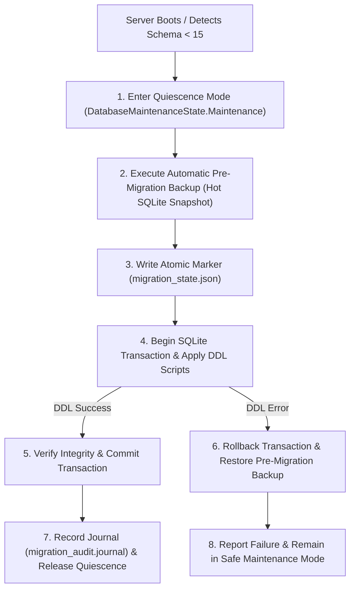

# Database Administration & Schema Migrations Guide

> [!NOTE]
> **Documentation Version Alignment**: Product: `1.0.0` | Protocol: `1` | Schema: `15` | Target OS: `Windows 10/11 x64`

This guide specifies database maintenance, concurrency tuning, schema migration engineering, and emergency rollback procedures for the authoritative SQLite engine in **GROZET RetailPOS**.

---

## 1. Authoritative SQLite Architecture

RetailPOS uses an embedded, high-performance SQLite database engine operating in single-process mode within the `GrozetPOSServer` Windows Service:

### Database Files Layout
All database files reside in:
`%ProgramData%\GROZET\RetailPOS\Database\`

```text
Database/
├── grozet_pos.db        # Primary SQLite database file
├── grozet_pos.db-wal    # Write-Ahead Log file (active uncommitted / committed pages)
└── grozet_pos.db-shm    # Shared-memory index file (used by WAL readers/writers)
```

> [!CAUTION]
> **WAL & SHM File Integrity**:
> Never delete `grozet_pos.db-wal` or `grozet_pos.db-shm` while the `GrozetPOSServer` service is running. Doing so will permanently corrupt active write transactions and cause database corruption.

---

## 2. Concurrency & Performance Tuning

Configured in `SqliteConnectionConfigurator.cs` for all SQLite connections:

1. **Write-Ahead Logging (`PRAGMA journal_mode = WAL;`)**:
   Instead of writing directly to the database file (which locks the entire database), changes are appended to the WAL file. Multiple counter terminals can read products, stock, and customer data simultaneously while the server writes an active sale.
2. **Normal Synchronization (`PRAGMA synchronous = NORMAL;`)**:
   Reduces disk flush latency by eliminating redundant sync flushes on WAL appends while maintaining full crash resistance against application and operating system terminations.
3. **5000ms Busy Timeout (`PRAGMA busy_timeout = 5000;`)**:
   Ensures that if two write transactions collide within the same millisecond, the calling thread waits and retries automatically for up to 5,000 milliseconds before throwing an exception.
4. **Foreign Key Enforcement (`PRAGMA foreign_keys = ON;`)**:
   Enforces relational constraints and cascading deletes across lines, sales, taxes, and sessions.
5. **Passive Checkpointing**:
   SQLite automatically checkpoints WAL pages back into `grozet_pos.db` when the WAL file reaches 1,000 pages (~4 MB), keeping memory and disk footprints minimal.

---

## 3. Authoritative Schema Versioning

RetailPOS maintains an immutable history of database schema migrations:
- **Baseline Schema**: **Version 14** (Established through Phase 16.5).
- **Current Target Schema**: **Version 15** (Phase 16.6 / 16.7 / 16.8 / 16.9 baseline).
- **Migration Registry**: Managed by `SchemaMigrationRegistry.cs`. Every schema change is registered with an explicit version integer, target description, forward SQL DDL script, and rollback SQL DDL script.

---

## 4. The Safe Migration Runner (`SafeMigrationRunner.cs`)

Database upgrades execute automatically on server startup or during installer updates using a fail-closed 6-step lifecycle:



### 1. Quiescence Mode Acquisition
Before applying schema changes, the runner requests exclusive maintenance access from `DatabaseMaintenanceCoordinator.cs`:
- State transitions to `DatabaseMaintenanceState.Maintenance`.
- Any incoming counter billing requests receive `503 Service Unavailable` with error code `DATABASE_MAINTENANCE`.
- Active reader connections are gracefully drained.

### 2. Mandatory Pre-Migration Backup
The runner automatically creates a verified SQLite hot backup in:
`%ProgramData%\GROZET\RetailPOS\Staging\Migration\pre_migration_backup_<Timestamp>.db`
If the pre-migration backup cannot be created (e.g. insufficient disk space), **the upgrade aborts immediately without touching the schema**.

### 3. Atomic Transaction Boundaries
All schema DDL statements for a migration step execute inside a single SQLite transaction (`BEGIN IMMEDIATE`). If any table creation, column addition, or index generation fails:
- The transaction rolls back automatically.
- The pre-migration backup is restored.
- The schema is guaranteed never to be left in a half-migrated state.

### 4. Migration Journaling
Every step is logged to an append-only journal:
`%ProgramData%\GROZET\RetailPOS\Logs\migration_audit.journal`

---

## 5. Migration Failure & Crash Recovery

### Handling Power Loss Mid-Migration
If the server PC experiences sudden power loss during a schema migration:
1. Upon reboot, `FilesystemReconciliationEngine.ReconcileStartupAsync()` scans `%ProgramData%\GROZET\RetailPOS\Staging\Migration\migration_state.json`.
2. If `migration_state.json` indicates an interrupted migration (`State: MigrationInProgress`), the engine automatically restores the verified `pre_migration_backup_<Timestamp>.db` snapshot.
3. The dirty migration marker is cleared, leaving the database clean and operational at the previous schema version.

### Emergency Loopback Rollback Engine
If an upgraded release experiences unexpected runtime incompatibilities after migration, the database can be rolled back via the secured loopback rollback endpoint:

- **Endpoint**: `POST http://127.0.0.1:5100/api/v1/recovery/restore-database`
- **Security Restrictions**:
  1. **Strict Loopback Binding**: The endpoint is accessible strictly from `127.0.0.1` or `::1`. Remote LAN counter requests are rejected with `403 Forbidden`.
  2. **Owner Role Authentication**: Must be authenticated using the primary Store Owner account credentials.
  3. **Exact Phrase Confirmation**: The payload must include the exact mandatory confirmation phrase:
     ```json
     {
       "confirmationPhrase": "RESTORE_DATABASE_AUTHORIZED_BY_OWNER"
     }
     ```

---

## 6. Client-Server Protocol Versioning

To prevent data corruption caused by version mismatches between checkout lanes and the server:
- Every HTTP request from a counter terminal transmits the header:
  ```http
  X-Client-Protocol-Version: 1
  ```
- The server validates this header via `ProtocolVersionMiddleware.cs`:
  - Current Server Protocol Version: `1`
  - Minimum Supported Client Protocol Version: `1`
- If an outdated or incompatible counter terminal connects, the server rejects the request with HTTP `426 Upgrade Required`:
  ```json
  {
    "success": false,
    "errorCode": "PROTOCOL_VERSION_MISMATCH",
    "message": "Terminal protocol version is incompatible with the server. Please upgrade the counter software."
  }
  ```
