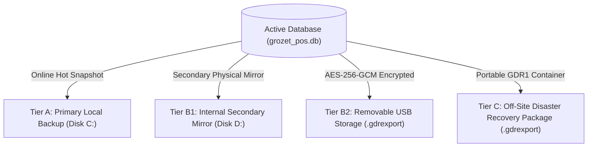
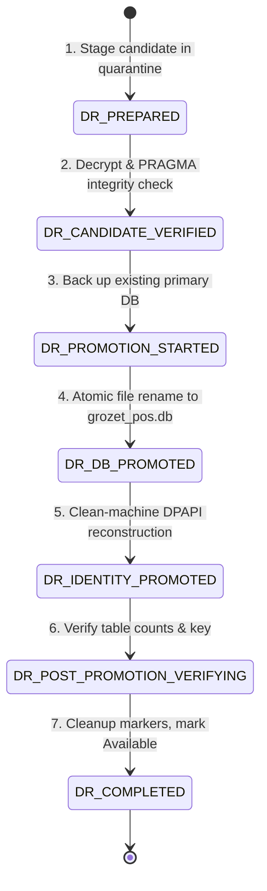

# Disaster Recovery & Backup Operations Guide

> [!NOTE]
> **Documentation Version Alignment**: Product: `1.0.0` | Protocol: `1` | Schema: `15` | Target OS: `Windows 10/11 x64`

This guide provides disaster recovery engineers, field support technicians, and database administrators with authoritative procedures for managing backups, executing restores, performing bare-metal recovery, and reconstructing store identity on clean Windows machines using **GROZET RetailPOS**.

---

## 1. Authoritative Backup Storage Hierarchy (A / B1 / B2 / C)

RetailPOS implements a defense-in-depth tiered backup model to protect store databases against physical drive failure, ransomware, and site disasters:



### Tier A: Local Primary Backup (Fast Operational Recovery)
- **Path**: `%ProgramData%\GROZET\RetailPOS\Backups\`
- **Format**: Plaintext SQLite snapshot generated via SQLite Online Backup API (`VACUUM INTO`) accompanied by a cryptographic companion manifest (`.manifest.json`) containing an HMAC-SHA256 integrity signature.
- **Use Case**: Rapid recovery from accidental operator errors or bad batch updates on the healthy primary server.

### Tier B1: Internal Secondary Storage Mirror (Local Drive Redundancy)
- **Path**: Secondary internal physical SSD/HDD partition (e.g. `D:\RetailPOS_Backups\`).
- **Format**: Plaintext SQLite snapshot + HMAC companion manifest.
- **Use Case**: Immediate failover if the primary operating system SSD experiences hardware failure.

### Tier B2: Removable USB Storage (Ransomware & Physical Protection)
- **Destination**: Removable USB 3.0 flash drive or external USB hard drive.
- **Format**: AES-256-GCM encrypted `.gdrexport` container.
- **Security Rule**: No plaintext SQLite files are ever written to removable USB media. Data at rest is encrypted using keys derived from the store recovery architecture.
- **Use Case**: Offline, air-gapped protection against cryptolocker ransomware.

### Tier C: Portable Off-Site Disaster Recovery Package (`GDR1` Container)
- **Format**: Authoritative `GDR1` encrypted container format:
  - Magic header: `GDR1` (4 bytes).
  - Version: `0x01` (1 byte).
  - Key Derivation: HKDF-SHA256 using info `"grozet-pos-portable-dr-export-v1"`.
  - Encryption: AES-256-GCM authenticated encryption.
  - Header Authenticated Data (AAD): Cryptographically binds Store ID, Store Name, Export Timestamp, Schema Version (15), and Protocol Version (1).
  - Pre-Publication Decryption Audit: The backup service performs an in-memory test decryption of the candidate export before writing it to disk. If decryption fails, the export is aborted immediately.
- **Use Case**: Transporting store data to a replacement server PC during catastrophic hardware failure.

---

## 2. Backup Retention & Storage Protection

To prevent runaway disk consumption:
1. **10 GB Storage Ceiling**: The backup management engine strictly enforces a 10 GB storage cap on the `%ProgramData%\GROZET\RetailPOS\Backups\` directory.
2. **Automated Pruning**: When the storage cap or maximum retention count is reached, the oldest verified backups are safely deleted.
3. **The Last Known Good Invariant**:
   > [!IMPORTANT]
   > The most recent cryptographically verified backup is **NEVER PRUNED**, even if retention limits or disk ceilings are set to zero. The system will never leave a store with zero recoverable backups.

---

## 3. Routine Restore Procedure (On Healthy Server PC)

A routine restore applies when the Server PC hardware and Windows OS are intact, but an administrator needs to revert the database to an earlier snapshot:

1. **Owner Authority Mandate**:
   Restoring a database replaces all store transactional data. Only the primary **Owner** role is authorized to initiate a restore (`admin:backup:restore`).
2. **Quiescence Mode**:
   The server acquires the `DatabaseMaintenanceCoordinator` gate, placing the server into `DatabaseMaintenanceState.Maintenance` mode. All counter terminal requests receive `503 Service Unavailable` (`DATABASE_MAINTENANCE`).
3. **Pre-Restore Quarantine Validation**:
   The candidate backup is copied to `%ProgramData%\GROZET\RetailPOS\Staging\Quarantine\`. The server validates:
   - HMAC-SHA256 signature against the companion manifest.
   - SQLite physical page integrity (`PRAGMA integrity_check`).
   - Store identity match (ensuring the backup belongs to this store).
4. **Promotion**:
   The server closes active SQLite connections, archives the current `grozet_pos.db` to `Staging\previous_grozet_pos.db`, promotes the verified snapshot to primary, and re-opens database connections.
5. **Reconciliation**:
   The maintenance gate is released (`DatabaseMaintenanceState.Available`), and counter terminals resume normal billing.

---

## 4. Bare-Metal & Clean-Machine Recovery Runbook

When the Server PC experiences catastrophic hardware failure (e.g. motherboard failure, fire, flood, theft) or Windows is reinstalled from scratch on replacement hardware:

### The Clean-Machine DPAPI Reconstruction Invariant
> [!CAUTION]
> **WHY OLD DPAPI IDENTITY FILES CANNOT BE COPIED**:
> Windows Data Protection API (DPAPI) encrypts `%ProgramData%\GROZET\RetailPOS\Security\store_identity.dat` using machine-specific cryptographic keys tied to the physical hardware and OS installation.
> 
> If a technician copies `store_identity.dat` from an old computer to a new computer, **DPAPI DECRYPTION FAILS WITH `CryptographicException`**.
> 
> **THE RECONSTRUCTION RULE**:
> Technicians must **NEVER** copy the old machine's `store_identity.dat`. Instead, the system executes the **Clean-Machine DPAPI Reconstruction** protocol using the physical Master Recovery Key.

### Step-by-Step Clean-Machine Reconstruction Workflow

1. **Install Server Software on Replacement PC**:
   - Run `GrozetRetailPOS_Server_Setup.exe` on the new Windows 10/11 machine.
   - Ensure the `GrozetPOSServer` service is installed and running under `NT SERVICE\GrozetPOSServer`.

2. **Stage Candidate Backup**:
   - Copy the latest B1, B2, or Tier C (`.gdrexport`) backup file to the replacement PC (e.g. `C:\Recovery\candidate_backup.gdrexport`).

3. **Retrieve Physical Master Recovery Key**:
   - Retrieve the sealed Master Recovery Key card from the store fireproof safe:
     ```text
     XXXX-XXXX-XXXX-XXXX-XXXX-XXXX-XXXX-XXXX
     ```

4. **Initiate Bare-Metal Disaster Recovery**:
   - In the Server management console or disaster recovery terminal, select **Bare-Metal Disaster Recovery**.
   - Browse to the candidate backup file.
   - Enter the 32-byte Store Master Recovery Key.

5. **Internal Cryptographic Execution**:
   - The recovery engine validates the recovery key against the candidate database's `master_key_validator_hash` via `ValidateMasterRecoveryKeyAgainstVerifier`.
   - The engine unwraps the original stable `StoreSigningKey` via `UnwrapStoreSigningKey`.
   - The engine constructs a **brand-new DPAPI `LocalMachine` identity** on the replacement PC using `InitializeNewStoreIdentityAsync`, generating fresh `InstallationId` and `InstallationSecret` values.
   - The original `StoreSigningKey` is preserved bit-for-bit, maintaining historical transaction verification integrity.
   - The candidate database is promoted to primary `%ProgramData%\GROZET\RetailPOS\Database\grozet_pos.db`.

---

## 5. The 7-State Disaster Recovery State Machine

The recovery engine (`FilesystemReconciliationEngine.cs` and `BackupService.cs`) enforces a crash-resilient 7-state machine tracked in `dr_recovery_state.json`:



### Crash Recovery Behavior
If power is abruptly cut mid-recovery:
- Upon reboot, `FilesystemReconciliationEngine.ReconcileStartupAsync()` reads `dr_recovery_state.json`.
- If interrupted in states 1–3 (`DR_PREPARED` to `DR_PROMOTION_STARTED`), the engine rolls back the candidate and restores the previous primary DB.
- If interrupted in states 4–6 (`DR_DB_PROMOTED` to `DR_POST_PROMOTION_VERIFYING`), the engine safely completes the remaining promotion steps or rolls back to the clean previous state.
- The database is only transitioned to `DatabaseMaintenanceState.Available` once `DR_COMPLETED` is achieved.

---

## 6. Technician Rules of Engagement (MUST & MUST NOT)

### What Technicians MUST Do:
- **MUST** verify physical disk space (at least 20 GB free) before initiating recovery.
- **MUST** verify that the Master Recovery Key card is physically signed and dated by the Store Owner.
- **MUST** let the 7-state recovery engine complete automatically without killing the `GrozetPOSServer` service process.
- **MUST** execute a test cashier login and bill transaction immediately after `DR_COMPLETED`.

### What Technicians MUST NOT Do:
- **MUST NOT** copy `store_identity.dat` from an old computer to a new computer.
- **MUST NOT** open, edit, or execute manual SQL queries on `grozet_pos.db` using external SQLite GUI tools during recovery.
- **MUST NOT** delete or edit `dr_recovery_state.json` or `migration_state.json` manually.
- **MUST NOT** transmit the Master Recovery Key over unencrypted email or chat.
