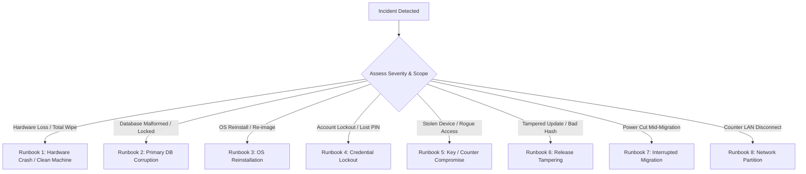

# Emergency Operational Runbooks

| Document Metadata | Value |
| :--- | :--- |
| **Document ID** | `GROZET-DOC-OPS-007` |
| **System Version** | `1.0.0` |
| **Target Audience** | Disaster Recovery Engineers, Support Technicians, Store Managers, Store Owners |
| **Classification** | Commercial Operations & Incident Response Standard Operating Procedures |

---

## 1. Incident Severity Matrix & Response SLAs

| Severity Level | Definition | Target Response Time | Authorized Incident Lead |
|---|---|---|---|
| **P1 - Critical Outage** | Complete store billing stoppage; primary server down; database corruption | **< 15 Minutes** | Store Owner / Certified DR Engineer |
| **P2 - Degraded Store** | Single counter disconnected; peripheral failure; secondary mirror desync | **< 30 Minutes** | Store Manager / Support Technician |
| **P3 - Administrative** | Password reset required; routine maintenance; report query timeout | **< 4 Hours** | Store Manager |

---

## 2. Emergency Runbooks



---

### Runbook 1: Complete Store Server Hardware Failure (Total Loss)

#### Incident Classification
* **Severity**: **P1 - Critical Outage**
* **Triggers**: Server motherboard failure, fire/water damage, hardware theft, unbootable blue screen.

#### Immediate Containment
1. Secure the physical premises and isolate any remaining functional hardware.
2. Halt all lane checkouts immediately; announce a temporary operational pause to shoppers.
3. Locate the **24-word Master Recovery Key (BIP-39)** from the physical safe and the latest **Off-Site Encrypted Container (Tier C: `GDR1`)** or **Tier B2 USB Drive**.

#### Step-by-Step Recovery Procedure
1. **Prepare Replacement Hardware**:
   * Minimum Specification: Windows 10/11 64-bit, 8GB RAM, SSD with > 32GB free space.
   * Connect replacement PC to the isolated store POS Ethernet switch.
2. **Install Operating System & Runtime**:
   * Complete clean Windows installation; set static IP matching previous server (e.g., `192.168.1.100`).
   * Set network profile to `Private`.
3. **Deploy GROZET RetailPOS Server**:
   * Run the production installer:
     ```powershell
     Start-Process -FilePath "GROZET-RetailPOS-Server-Setup.exe" -ArgumentList "/qn" -Wait
     ```
   * Stop the service before restoring data:
     ```powershell
     Stop-Service -Name GrozetPOSServer
     ```
4. **Execute Clean-Machine Disaster Recovery**:
   * Run the disaster recovery engine:
     ```powershell
     & "C:\Program Files\GROZET\RetailPOS\Server\RetailPOS.Server.exe" --disaster-recovery `
         --source "D:\GROZET_BACKUPS\BACKUP_LATEST.gdrexport" `
         --recovery-key "word1 word2 ... word24"
     ```
   * The recovery utility will:
     1. Decrypt the `GDR1` container using the 24-word Master Recovery Key.
     2. Reconstruct the local Store Identity and wrapping key in Windows DPAPI for `NT SERVICE\GrozetPOSServer`.
     3. Restore SQLite database files (`pos_primary.db`) and verify HMAC integrity.
5. **Start Service & Re-establish Counter Connections**:
   ```powershell
   Start-Service -Name GrozetPOSServer
   curl http://127.0.0.1:5100/health
   ```
6. **Counter Terminal Re-Pairing**:
   * Open the Store Management Console on the server.
   * Generate an 80-bit CSPRNG `HumanPairingCode` (16 Crockford Base32 characters `XXXX-XXXX-XXXX-XXXX`) for each checkout counter.
   * Re-pair each counter and verify matching 8-character SAS (`XXXX-XXXX`).

---

### Runbook 2: Server SSD / Database Corruption (`pos_primary.db` Damaged)

#### Incident Classification
* **Severity**: **P1 - Critical Outage**
* **Triggers**: SQLite error `disk image is malformed`, unexpected server reboot during WAL flush, storage block failure.

#### Immediate Containment
1. Stop the Windows service immediately to prevent write pollution:
   ```powershell
   Stop-Service -Name GrozetPOSServer -Force
   ```
2. Archive the corrupted database folder for post-mortem forensics:
   ```powershell
   Copy-Item -Path "C:\ProgramData\GROZET\RetailPOS\Database" -Destination "C:\ProgramData\GROZET\RetailPOS\Database_CORRUPT_ARCHIVE" -Recurse
   ```

#### Step-by-Step Restoration Procedure
1. **Inspect Secondary Local Mirror (Tier B1)**:
   * Navigate to `C:\ProgramData\GROZET\RetailPOS\Mirrors\`.
   * Check HMAC signature file `pos_primary.db.hmac` against the mirror database.
2. **Restore from Tier B1 (Fast Recovery - Preferred)**:
   ```powershell
   # Validate mirror HMAC and restore
   Copy-Item -Path "C:\ProgramData\GROZET\RetailPOS\Mirrors\pos_primary.db" -Destination "C:\ProgramData\GROZET\RetailPOS\Database\pos_primary.db" -Force
   Remove-Item "C:\ProgramData\GROZET\RetailPOS\Database\pos_primary.db-wal" -Force -ErrorAction SilentlyContinue
   Remove-Item "C:\ProgramData\GROZET\RetailPOS\Database\pos_primary.db-shm" -Force -ErrorAction SilentlyContinue
   ```
3. **Restore from Tier B2 (Removable USB Export - Fallback)**:
   * If Tier B1 mirror is also compromised or invalid, attach the B2 USB drive.
   * Execute backup restoration utility with the store passphrase.
4. **Verify Database Integrity**:
   ```powershell
   # Start service in verify mode
   & "C:\Program Files\GROZET\RetailPOS\Server\RetailPOS.Server.exe" --verify-integrity
   ```
5. **Start Service & Resume Trading**:
   ```powershell
   Start-Service -Name GrozetPOSServer
   ```

---

### Runbook 3: Operating System Reinstallation / Clean Wipe

#### Incident Classification
* **Severity**: **P1 / Maintenance Recovery**
* **Triggers**: Windows OS corruption, malware containment wipe, drive replacement.

#### Procedure
1. **Reinstall Windows**:
   * Install Windows 10/11 Enterprise or Pro (64-bit).
   * Apply all cumulative security updates.
   * Configure static network adapter IP and set network to `Private`.
2. **Re-Provision Virtual Service Account & File Permissions**:
   * Execute official setup installer to create `NT SERVICE\GrozetPOSServer` and create `%ProgramData%\GROZET\RetailPOS` directory with stripped inherited permissions.
3. **Execute Clean-Machine DPAPI Reconstruction**:
   * Use the 24-word Master Recovery Key to restore the Store Identity into the clean OS DPAPI store (see Runbook 1, Step 4).
4. **Verify Server Liveness**:
   * Query `http://127.0.0.1:5100/health` to confirm database connectivity, schema integrity, and quiescence `Ready`.

---

### Runbook 4: Lost Cashier / Manager PIN or Password

#### Incident Classification
* **Severity**: **P3 - Administrative**
* **Triggers**: Cashier forgot 4-digit PIN; store manager locked out due to exceeding maximum failed login attempts (5 attempts).

#### Procedure
1. **Cashier PIN Reset (Standard Manager Procedure)**:
   * Store Manager logs in to the Management Portal on any authorized terminal.
   * Navigate to **Administration > User Accounts > Select Staff Member**.
   * Click **Reset PIN**, enter new temporary 4-digit PIN, and tick **Require PIN change at next login**.
2. **Store Manager / Owner Account Recovery (Privileged Override)**:
   * If the sole administrator is locked out or password is forgotten:
   * Physically access the Store Server console.
   * Launch the Administrative Recovery Utility:
     ```powershell
     & "C:\Program Files\GROZET\RetailPOS\Server\RetailPOS.Server.exe" --reset-owner-credential
     ```
   * Operator must enter the 24-word Master Recovery Key mnemonic.
   * Set new Owner username and strong password.
   * An immutable audit log entry `EVENT_SEC_OWNER_RECOVERY_OVERRIDE` is written to the cryptographic audit log.

---

### Runbook 5: Suspected Cryptographic Key Compromise or Stolen Counter Terminal

#### Incident Classification
* **Severity**: **P1 - Critical Security Threat**
* **Triggers**: Physical theft of counter terminal, unauthorized terminal observed sending requests, credential leak.

#### Immediate Containment
1. **Revoke Counter Terminal Token**:
   * On the server console or manager portal, navigate to **Administration > Registered Terminals**.
   * Select the stolen or compromised terminal (e.g., `COUNTER-03`).
   * Click **Revoke Terminal Authorization** immediately.
   * Server immediately blacklists the terminal's hardware fingerprint and cancels its SRP session key.

#### Key Rotation & Re-Pairing
1. **Rotate Store Communication Signing Keys**:
   * In the management console, execute **Security > Rotate Active Counter Keyring**.
   * This invalidates all active counter session tokens storewide.
2. **Re-Pair Valid In-Store Terminals**:
   * For each legitimate terminal on the floor, generate a new 80-bit CSPRNG pairing code (`XXXX-XXXX-XXXX-XXXX`).
   * Complete pairing and confirm matching 8-character SAS (`XXXX-XXXX`).

---

### Runbook 6: Release Verification Failure / Suspected Tampering

#### Incident Classification
* **Severity**: **P1 - Security Alert**
* **Triggers**: Update installer fails Authenticode signature check, CMS manifest verification fails, or SHA-256 hash mismatch.

#### Immediate Containment
1. **Terminate Update Process Immediately**:
   * The update manager automatically halts installation and prevents executable execution.
   * Do NOT click "Run Anyway" or bypass security prompts.
2. **Isolate Installation Package**:
   * Quarantine the untrusted package to prevent accidental execution:
     ```powershell
     Move-Item -Path "C:\ProgramData\GROZET\RetailPOS\Updates\*" -Destination "C:\ProgramData\GROZET\RetailPOS\Quarantine\"
     ```

#### Verification & Escalation
1. **Inspect Authenticode Digital Signature**:
   ```powershell
   Get-AuthenticodeSignature "C:\ProgramData\GROZET\RetailPOS\Quarantine\GROZET-RetailPOS-Server-Setup.exe" | Format-List *
   ```
   * Verify Publisher is `GROZET SOFTWARE SOLUTIONS PRIVATE LIMITED`.
   * Verify Status is `Valid`. If status is `HashMismatch`, `NotSigned`, or `UntrustedRoot`, the package is compromised or corrupted.
2. **Verify CMS Release Manifest**:
   ```powershell
   & "C:\Program Files\GROZET\RetailPOS\Server\RetailPOS.Server.exe" --verify-release-manifest `
       --manifest "release_manifest.json" --signature "release_manifest.json.p7s"
   ```
3. **Escalate to GROZET Security Desk**:
   * Report incident with SHA-256 hash and package source URL.
   * Revert to the last known verified release package.

---

### Runbook 7: Interrupted Database Migration (Power Cut Mid-Migration)

#### Incident Classification
* **Severity**: **P1 - Operational Failure**
* **Triggers**: Store power loss or unexpected server shutdown while executing a schema migration (e.g., migrating to Schema 15).

#### Detection
Upon reboot and service startup, `RetailPOS.Server` evaluates database state:
* Health endpoint `/health` reports `Status: Degraded`, `MigrationStatus: Interrupted`.
* Serilog log records: `FATAL: Migration interrupted mid-transaction. Quiescence engine in lock state.`

#### Rollback & Recovery Workflow
```powershell
# 1. Ensure service is stopped
Stop-Service -Name GrozetPOSServer

# 2. Inspect Pre-Migration Snapshot in Migration Archive
Get-ChildItem "C:\ProgramData\GROZET\RetailPOS\Database\PreMigrationSnapshots"

# 3. Execute Automated Migration Rollback Engine
& "C:\Program Files\GROZET\RetailPOS\Server\RetailPOS.Server.exe" --rollback-migration

# 4. Verify Database Reverted to Target Previous Version
& "C:\Program Files\GROZET\RetailPOS\Server\RetailPOS.Server.exe" --verify-integrity

# 5. Start Service in Quiescent Maintenance Mode
Start-Service -Name GrozetPOSServer
```
* The rollback engine validates the pre-migration snapshot HMAC, replaces the corrupted migration workspace, and restores the database to the clean pre-migration schema.
* Once verified, the technician may re-attempt the migration with stable AC power.

---

### Runbook 8: Counter Terminal Network Partition (Cable Severed / Switch Failure)

#### Incident Classification
* **Severity**: **P2 - Degraded Store Operation**
* **Triggers**: Counter terminal displays `Connection Lost to Store Server`; switch port offline; damaged RJ-45 cable.

> [!CRITICAL]
> **Strict Policy Enforcement**:
> GROZET RetailPOS operates strictly on an **authoritative local server architecture**.
> **There is NO offline transaction queue and NO offline cash billing mode.**
> Counter terminals CANNOT issue sales receipts or complete checkouts without active server validation.

#### Step-by-Step Resolution Procedure
1. **Halt Lane Checkout**:
   * Cashier informs customer that terminal is verifying network connection.
   * Do NOT calculate totals manually or accept cash.
2. **Physical Layer Diagnostics**:
   * Inspect the physical Ethernet cable at both the POS terminal and the network switch.
   * Verify LED link/activity lights on the NIC.
   * If link light is dark: replace patch cable with tested Cat6 cable.
3. **Network Stack Diagnostics**:
   ```powershell
   # Test gateway ping
   ping 192.168.1.1 -n 2

   # Test POS server connectivity
   Test-NetConnection -ComputerName 192.168.1.100 -Port 5100
   ```
4. **Switch Hardware Failure**:
   * If multiple counters lose connection simultaneously, power-cycle the store POS network switch.
   * If switch port is damaged, move uplink cable to an open functional port.
5. **Reconnection & State Resumption**:
   * As soon as network connectivity is restored, the WinUI 3 counter terminal automatically re-establishes its authenticated session.
   * The cashier's in-progress cart is re-synchronized with the authoritative server state.
   * Billing resumes without data loss or duplicate receipts.

---

## 3. Post-Incident Review & Sign-Off Checklist

Following resolution of any P1 incident, the following sign-off checklist must be completed before returning the store to normal operations:

- [ ] **Database Integrity**: `PRAGMA integrity_check` executed with zero errors.
- [ ] **Data Mirroring Active**: Tier B1 local secondary mirror verified and in sync.
- [ ] **Peripheral Connectivity**: Receipt printer, cash drawer kick, and barcode scanner verified on all lanes.
- [ ] **Fiscal Audit Log**: Transaction sequence continuity verified; zero missing invoice numbers.
- [ ] **Incident Logged**: Full post-mortem report filed with GROZET Support Desk within 24 hours.
