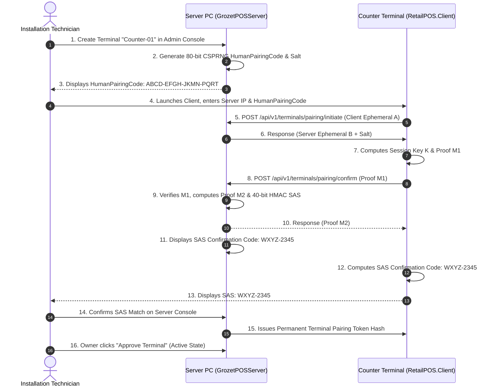

# First-Run Setup & Store Initialization Guide

> [!NOTE]
> **Documentation Version Alignment**: Product: `1.0.0` | Protocol: `1` | Schema: `15` | Target OS: `Windows 10/11 x64`

This guide instructs store owners and deployment technicians on the mandatory one-time setup workflow required immediately after installing **GROZET RetailPOS** on a fresh Windows system.

---

## 1. First-Run Provisioning Overview

When `GrozetPOSServer` boots on a clean machine for the very first time, the database is in an uninitialized state:
1. No store profile exists.
2. No user accounts exist.
3. No cryptographic store identity or encryption keys exist.
4. No counter terminals are enrolled.

The system will display the **First-Run Provisioning Wizard** when `RetailPOS.Client.exe` connects locally, or when an administrator browses to the server management portal.

---

## 2. Step 1: Store Information Registration

In the Store Details screen, configure the store's primary business metadata:
- **Store Name**: Legal business or trading name (e.g. *"Grozet Supermarket"*).
- **Tax Registration / GSTIN**: 15-character Goods and Services Tax Identification Number.
- **Store Address & Contact**: Physical store address, phone number, and support email (printed on receipt headers).
- **Currency & Decimal Precision**: Default currency is INR (`₹`), with financial precision locked to integer paise (100 paise = ₹1.00).

---

## 3. Step 2: Primary Owner Account Provisioning

The initial user account created during first-run setup is assigned the authoritative **Owner** role:
- **Username**: Administrative login username (e.g. `owner` or store proprietor name).
- **Password**: Strong administrative password (minimum 8 characters with upper, lower, numbers, and symbols).
- **Owner PIN**: 4-to-6 digit numeric PIN for fast terminal unlocking and supervisor approval authorization.

> [!IMPORTANT]
> **Owner Role Authority**:
> The `Owner` role holds 100% of the 32 canonical domain permissions. Only the `Owner` account is permitted to:
> 1. Execute database restorations (`admin:backup:restore`).
> 2. Change user roles (`admin:users:role`).
> 3. Modify core store security settings (`admin:settings:manage`).
> The Owner password and PIN must be guarded strictly and **never shared with cashiers**.

---

## 4. Step 3: Store Identity & Master Recovery Key Generation

Upon saving the Owner account, the server's cryptographic provisioning engine (`StoreIdentityService.cs`) executes an atomic key generation ceremony:

### What Happens Cryptographically
1. **Store Signing Key Generation**: The server generates an internal 256-bit cryptographically secure random `StoreSigningKey`.
2. **Master Recovery Key Generation**: The server generates a random 256-bit (32-byte) `StoreMasterRecoveryKey`.
3. **Key Wrapping**: Using HKDF-SHA256 with derivation info `"grozet-pos-store-key-wrapping-v1"`, the server derives an encryption key from the recovery key and wraps the `StoreSigningKey` via AES-256-GCM.
4. **HMAC Validator Generation**: The server derives an HMAC validator hash using HKDF info `"grozet-pos-store-key-validation-v1"` and stores it inside the SQLite database table `store_identity`.
5. **DPAPI Protection**: The active store identity is encrypted using Windows Data Protection API (`DataProtectionScope.LocalMachine`) and written to `%ProgramData%\GROZET\RetailPOS\Security\store_identity.dat`.

### Display & Physical Storage Protocol
The wizard will display the generated **Store Master Recovery Key** on the screen formatted into 8 groups of 4 characters:

```text
XXXX-XXXX-XXXX-XXXX-XXXX-XXXX-XXXX-XXXX
```

> [!CAUTION]
> **CRITICAL SECURITY REQUIREMENT — STORE MASTER RECOVERY KEY**:
> The Master Recovery Key is displayed **EXACTLY ONCE** during this provisioning ceremony.
> The server **NEVER STORES** this recovery key on disk or in the database.
> 
> **MANDATORY TECHNICIAN / OWNER PROTOCOL**:
> 1. Click **"Print Recovery Card"** to produce two physical printed paper cards containing the 32-byte recovery key.
> 2. The Store Owner must physically sign and date both cards.
> 3. Place Card 1 in a sealed opaque envelope inside the **Store Fireproof Safe**.
> 4. Place Card 2 in the owner's off-site security deposit box or corporate lockbox.
> 5. **NEVER** save the key in a text file on the PC desktop.
> 6. **NEVER** take a smartphone photo of the screen.
> 7. **NEVER** transmit the key via email, WhatsApp, or messaging apps.
> 
> *If the Server PC hardware is destroyed in the future, bare-metal recovery to a new computer is mathematically impossible without this physical Master Recovery Key.*

---

## 5. Step 4: Counter Terminal Enrollment & Pairing

In a multi-counter store, each checkout lane PC must be cryptographically paired with the Server PC before it is permitted to process billing transactions.

RetailPOS uses the **SRP-6a (Secure Remote Password)** protocol, providing mutual zero-knowledge proof authentication without ever transmitting pairing passwords across the network.

### Pairing Sequence



### Step-by-Step Counter Pairing Instructions

1. **Initiate Pairing on Server**:
   - In the Server Admin Console, navigate to **Settings** $\rightarrow$ **Terminals** $\rightarrow$ **Enroll New Terminal**.
   - Enter a Terminal Name (e.g. `"Counter-01"`) and select the lane location.
   - Click **Generate Pairing Session**.
   - The server displays:
     - **HumanPairingCode**: An 80-bit CSPRNG value formatted as 16 Crockford Base32 characters: `XXXX-XXXX-XXXX-XXXX` (e.g. `ABCD-EFGH-JKMN-PQRT`).
     - **Session Timeout**: 10-minute active window.

2. **Enter Pairing Code on Counter PC**:
   - Launch `RetailPOS.Client.exe` on the counter PC.
   - If automated UDP discovery finds the server, the server IP will be populated automatically; otherwise, enter the Server IP manually (e.g. `192.168.1.10:5100`).
   - Enter the 16-character `HumanPairingCode`.
   - Click **Pair with Server**.

3. **Verify the Short Authentication String (SAS)**:
   - Both the Server console and Counter terminal screen will compute and display an 8-character Crockford Base32 **SAS Confirmation Code** formatted as `XXXX-XXXX` (e.g. `WXYZ-2345`).
   - The technician must visually confirm that the 8 characters displayed on the Server PC match the 8 characters on the Counter Terminal PC.
   - This cryptographic SAS step guarantees that no man-in-the-middle device has intercepted the LAN pairing handshake.
   - Click **Confirm SAS Match** on the server console.

4. **Owner Approval Gate**:
   - The terminal transitions to `PendingApproval` state.
   - The Store Owner or Manager enters their PIN on the server console and clicks **Approve Terminal**.
   - The terminal transitions to `Active` state.
   - The counter terminal is now authorized for cashier login and sales processing.
