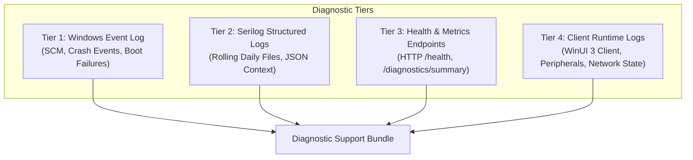

# Support Diagnostics & Troubleshooting Manual

| Document Metadata | Value |
| :--- | :--- |
| **Document ID** | `GROZET-DOC-OPS-006` |
| **System Version** | `1.0.0` |
| **Target Audience** | Support Technicians, Installation Technicians, Store Managers, DR Engineers |
| **Classification** | Commercial Operations & Maintenance Specification |

---

## 1. Diagnostic Architecture Overview

GROZET RetailPOS implements a **4-Tier Diagnostics Architecture** designed to isolate operational issues across the server operating system, application runtime, network transport, and client peripheral layers.



### 1.1 Tier 1: Windows Event Log
* **Log Name**: `Application`
* **Source**: `GrozetPOSServer` / `.NET Runtime` / `Service Control Manager`
* **Event IDs**:
  * `Event ID 1000 / 1026`: .NET Core Fatal Crash / Unhandled Exception.
  * `Event ID 7000 / 7009`: Windows Service Control Manager timeout or launch failure.
  * `Event ID 10000+`: Application-level startup, shutdown, and migration lifecycle events.

### 1.2 Tier 2: Serilog Structured Server Logs
* **File Location**: `%ProgramData%\GROZET\RetailPOS\Logs\grozet-server-.log`
* **Rotation Policy**: Daily rolling files; retained for 30 days before automated deletion.
* **Format**: Structured log format with timestamp, log level, correlation ID, component context, and structured exception details.

### 1.3 Tier 3: Health & Operational Endpoints
* **Liveness Probe**: `GET http://127.0.0.1:5100/health` (Returns HTTP 200 `Healthy` with database connection status, schema version, and quiescence state).
* **Supervisory Summary**: `GET http://127.0.0.1:5100/api/v1/diagnostics/summary` (Requires supervisor authentication; returns active connected counter sessions, database file size, WAL size, and backup schedule telemetry).

### 1.4 Tier 4: Client-Side Logs & UI Diagnostics
* **File Location**: `%LOCALAPPDATA%\GROZET\RetailPOS\Client\Logs\grozet-client-.log`
* **Scope**: UI event tracking, local network state transitions, peripheral communication errors (printer, scanner, scale, cash drawer), and counter connection lifecycle.

---

## 2. PII Redaction, Privacy & Information Boundaries

To maintain compliance with commercial privacy standards and customer data regulations, diagnostic logs strictly enforce redactor and auditor boundaries.

### 2.1 Redactor Rules (Enforced at Runtime)
The logging engine applies automatic masking filters to ensure sensitive data is never written to disk:
1. **Passwords & PINs**: Cashier PINs and manager passwords are replaced with `[REDACTED_SECRET]`.
2. **Master Recovery Keys**: 24-word BIP-39 mnemonic phrases and base64 seed strings are completely filtered.
3. **Cryptographic Tokens**: SRP-6a ephemeral values (`A`, `B`), session keys (`K`), and HMAC secrets are suppressed.
4. **Payment Data**: Cardholder account numbers, UPI transaction tokens, and authorization IDs are masked (e.g., `Card: **** **** **** 4012`).

### 2.2 Information Boundaries & Support Sharing
* **Safe for Support Sharing**:
  * Diagnostic support bundles containing Event Viewer logs, Serilog server logs, client runtime logs, and schema migration records.
  * Hardware communication logs and network interface binding summaries.
* **Store Owner Consent Required**:
  * Database transaction summaries, product catalog export dumps, or sales volume statistics.
* **Strictly Prohibited from Export**:
  * Database primary files (`pos_primary.db`), DPAPI master key files (`%APPDATA%\Microsoft\Protect`), or backup encryption keys.

---

## 3. Support Matrix: 17 Concrete Operational Problems & Solutions

| # | Problem Symptom | Primary Root Cause | Resolution Summary |
|---|---|---|---|
| **1** | Service fails to start (`ServiceStartError`) | Directory ACL permission denial or file lock | Verify NTFS ACLs on `%ProgramData%\GROZET\RetailPOS` and inspect Event Viewer |
| **2** | Port conflict on TCP 5100/5101 | Another process bound to POS port | Identify PID via `netstat` and terminate or reconfigure competing software |
| **3** | Client pairing SAS mismatch | Wrong code entered or rogue server on LAN | Verify 80-bit code `XXXX-XXXX-XXXX-XXXX` and compare 8-char SAS `XXXX-XXXX` on both screens |
| **4** | Invalid HumanPairingCode format | Typo or missing characters | Ensure exactly 16 Crockford Base32 characters formatted as 4 chunks of 4 |
| **5** | UDP 5105 discovery packet timeout | Windows Firewall profile set to Public | Change network profile to Private and verify UDP 5105 inbound rule |
| **6** | Cash session opening error | Register has unclosed previous shift | Close prior session from manager portal or perform supervisor reconciliation |
| **7** | Cash drawer fails to kick | RJ-11 cable unplugged or wrong voltage pin | Check printer RJ-11 connection, 24V vs 12V drawer solenoid, and printer queue |
| **8** | Receipt printer prints garbage text | ESC/POS baud rate or code page mismatch | Set serial baud rate to 9600/115200 and verify printer code page in settings |
| **9** | Barcode scanner truncates UPC/EAN digits | Scanner suffix/transmission format misconfigured | Scan vendor barcode to enable UPC-A lead digit and checksum transmission |
| **10** | Weighing scale Tare drift or negative weight | Uncalibrated scale or RS-232 framing error | Perform zero/tare calibration and set 8-N-1 9600 baud serial parameters |
| **11** | SQLite `database is locked` error | Antivirus locking WAL file or slow disk flush | Add `%ProgramData%\GROZET\RetailPOS` to AV exclusions; verify fast SSD storage |
| **12** | Database integrity check failure | Dirty page cache or abrupt hard power loss | Run repair utility or restore from automated secondary mirror backup B1 |
| **13** | Schema migration failure on startup | Incompatible schema version or disk full | Inspect migration log, verify disk space, or roll back using pre-migration snapshot |
| **14** | Backup generation failure | Target drive full or USB disconnected | Free up disk space (10GB threshold) or remount target USB storage unit |
| **15** | Backup validation HMAC error | Damaged `.gdrexport` archive or bit rot | Reject corrupt backup; fetch previous verified backup archive |
| **16** | SmartScreen / Authenticode warning | Untrusted root or newly signed package reputation | Verify digital signature with `signtool` and confirm enterprise root CA trust |
| **17** | Counter disconnected mid-transaction | Physical LAN drop; **Offline billing strictly disabled** | Halt sales immediately; restore LAN connectivity; server is authoritative |

---

## 4. In-Depth Troubleshooting Workflows

### 4.1 Problem 1: Service Fails to Start (`ServiceStartError`)
**Symptoms**: Windows Service Control Manager reports: `Error 1053: The service did not respond to the start or control request in a timely fashion` or service enters `Stopped` state immediately after start.

**Diagnostic Workflow**:
```powershell
# 1. Query service status and configuration
sc.exe query GrozetPOSServer
sc.exe qc GrozetPOSServer

# 2. Inspect Windows Application Event Log
Get-EventLog -LogName Application -Source "GrozetPOSServer", ".NET Runtime", "Service Control Manager" -Newest 10 | Format-List TimeGenerated, EntryType, Message

# 3. Check NTFS Access Control Lists on Data Directory
icacls "C:\ProgramData\GROZET\RetailPOS"
```
**Resolution Steps**:
1. If permissions show `NT SERVICE\GrozetPOSServer` is missing `(M)` or `(F)` access to `ProgramData\GROZET\RetailPOS`, execute:
   ```powershell
   icacls "C:\ProgramData\GROZET\RetailPOS" /grant "NT SERVICE\GrozetPOSServer:(OI)(CI)M" /T
   ```
2. Verify that `C:\Program Files\GROZET\RetailPOS\Server\RetailPOS.Server.exe` has Read & Execute permissions for the service account.
3. Test launch in interactive mode to observe direct console output:
   ```powershell
   & "C:\Program Files\GROZET\RetailPOS\Server\RetailPOS.Server.exe" --environment Production
   ```

---

### 4.2 Problem 2: Port Conflict on TCP 5100 / 5101
**Symptoms**: Server logs record `System.IO.IOException: Failed to bind to address http://0.0.0.0:5100: address already in use`.

**Diagnostic Workflow**:
```powershell
# Find which process owns port 5100
$netstat = netstat -ano | findstr :5100
Write-Host $netstat
$pidNumber = ($netstat -split '\s+')[-1]

# Identify the process name
Get-Process -Id $pidNumber | Select-Object Id, ProcessName, Path
```
**Resolution Steps**:
1. If an orphaned instance of `RetailPOS.Server` is holding the port, terminate it:
   ```powershell
   Stop-Process -Id $pidNumber -Force
   ```
2. If another application (e.g., IIS, dev proxy, conflicting service) is bound to 5100, reconfigure or disable the competing application, or adjust the RetailPOS server binding port in `appsettings.Production.json`.

---

### 4.3 Problems 3 & 4: Counter Pairing Failures (Format & SAS Mismatch)
**Symptoms**: Counter terminal UI displays `Pairing Failed: SAS Mismatch` or `Invalid Pairing Code Format`.

**Diagnostic Rules**:
* **HumanPairingCode Validation**:
  * Must be exactly 16 Crockford Base32 characters: `[0-9A-HJKMNP-TV-Z]`. (Excludes `I`, `L`, `O`, `U` to eliminate human transcription ambiguity).
  * Format: Four groups of four alphanumeric characters separated by hyphens (`XXXX-XXXX-XXXX-XXXX`).
* **Short Authentication String (SAS) Validation**:
  * Derived cryptographically via HMAC from the ephemeral SRP-6a exchange.
  * Must display identically on the server console and counter terminal screen (8 Crockford characters `XXXX-XXXX`).

**Resolution Steps**:
1. If the operator misread letters (e.g., mistaking `8` for `B` or entering `O` instead of `0`), re-enter the code carefully.
2. If the SAS does not match:
   > [!CAUTION]
   > A SAS mismatch indicates either an active Man-In-The-Middle (MITM) attack on the local network or that the counter is attempting to pair with a different server instance on the LAN. **Do NOT approve pairing if the SAS strings differ.**
3. Verify that only one RetailPOS server is operating on the store subnet.
4. Regenerate a new pairing code from the Store Management Console and re-pair.

---

### 4.4 Problem 5: UDP 5105 Discovery Packet Timeout
**Symptoms**: Counter terminal reports `Searching for Server...` indefinitely and fails to detect the server automatically.

**Diagnostic Workflow**:
```powershell
# 1. Check network adapter connection profile
Get-NetConnectionProfile

# 2. Check if UDP 5105 firewall rule exists and is enabled
Get-NetFirewallRule -DisplayName "*GROZET*" | Format-Table Name, DisplayName, Enabled, Direction, Action
```
**Resolution Steps**:
1. If the Network Category is `Public`, Windows blocks broadcast/multicast discovery packets. Switch the network profile to `Private`:
   ```powershell
   Set-NetConnectionProfile -InterfaceAlias "Ethernet" -NetworkCategory Private
   ```
2. Verify that inbound UDP port 5105 is permitted:
   ```powershell
   New-NetFirewallRule -DisplayName "GROZET RetailPOS Discovery (UDP-In)" `
       -Direction Inbound -Protocol UDP -LocalPort 5105 `
       -Action Allow -Profile Private
   ```
3. If network switches enforce IGMP Snooping or block broadcast traffic, use **Manual Server IP Configuration** on the counter client settings screen: `http://192.168.1.100:5100`.

---

### 4.5 Problem 6: Cash Session Opening Error
**Symptoms**: Cashier clicks *Open Shift* and receives error: `Register has unclosed active session (Session #1042)`.

**Resolution Steps**:
1. Identify which cashier or counter terminal owns the open session.
2. If the previous cashier forgot to close their shift, have that cashier log in and perform **Shift End Reconciliation**.
3. If the counter machine crashed or is inaccessible:
   * A user with `ManageStoreOperations` or `OverrideManager` permissions must log in to the Management Portal.
   * Navigate to **Operations > Cash Sessions > Active Sessions**.
   * Select Session `#1042` and execute **Force Close Session with Supervisor Override**.
   * Enter the physical cash count counted from the drawer and append supervisory notes.

---

### 4.6 Problems 7, 8, 9 & 10: Hardware & Peripheral Failures
* **Cash Drawer (Problem 7)**:
  * Check RJ-11 cable connection to the receipt printer's DK (Drawer Kick) port.
  * Check printer properties > Device Settings > Cash Drawer: ensure option is set to *Open Before Printing* or *Open After Printing*.
  * Solenoid voltage check: verify drawer requires 24V (standard POS printer kick) rather than 12V.
* **Printer Garbled Output (Problem 8)**:
  * Ensure printer DIP switches or firmware settings match the configured ESC/POS code page (e.g., Code Page 437 / WPC1252).
  * For serial connections, ensure baud rate is set to 9600 or 115200 with 8 Data Bits, 1 Stop Bit, and No Parity (8-N-1).
* **Barcode Scanner Truncation (Problem 9)**:
  * Program the scanner by scanning the configuration barcode: **Convert UPC-E to UPC-A: Disabled**, **Transmit Lead Digit: Enabled**, **Transmit Check Digit: Enabled**.
* **Weighing Scale Drift (Problem 10)**:
  * Ensure the scale platter is clear and level.
  * Execute zero calibration button on scale front panel.
  * Verify serial flow control (RTS/CTS or XON/XOFF) matches the POS hardware configuration.

---

### 4.7 Problems 11 & 12: SQLite Database Locks & Integrity Errors
**Symptoms**: API responses return `SQLite Error 5: 'database is locked'` or `SQLite Error 11: 'database disk image is malformed'`.

**Diagnostic Workflow**:
```powershell
# Stop service before running direct integrity pragma
Stop-Service -Name GrozetPOSServer

# Run SQLite integrity check using command-line tool (or management utility)
$dbPath = "C:\ProgramData\GROZET\RetailPOS\Database\pos_primary.db"
# PRAGMA integrity_check;
```
**Resolution Steps**:
1. **Database Locked**:
   * Verify that anti-virus software is not scanning active SQLite files (`pos_primary.db`, `pos_primary.db-wal`, `pos_primary.db-shm`). Add folder exclusion for `%ProgramData%\GROZET\RetailPOS\Database\`.
   * Verify that the database is configured in `WAL` journal mode and `busy_timeout` is set to at least 5000ms.
2. **Integrity Corruption**:
   * If `PRAGMA integrity_check` returns corruption errors:
   * Attempt SQLite WAL recovery: restart service cleanly to allow SQLite to replay the write-ahead log.
   * If corruption persists, initiate **Emergency Recovery Runbook 2** to restore from the verified local mirror backup `B1`.

---

### 4.8 Problem 17: Counter Disconnected Mid-Transaction (Strict Network Policy)
**Symptoms**: Counter terminal displays `Connection Lost to Store Server` with a red warning banner.

> [!CRITICAL]
> **Strict Locked Architecture Rule**:
> GROZET RetailPOS operates strictly as an **authoritative local server architecture**.
> **There is NO offline transaction queue and NO unverified offline cash billing.**
> Disconnected counter terminals are prohibited from completing sales independently.

**Resolution Steps**:
1. **Cashier Protocol**:
   * Politely ask the customer to pause for a moment while the counter verifies connection.
   * Do NOT accept cash, do NOT hand over goods, and do NOT manually open the cash drawer.
2. **Technical Resolution**:
   * Check physical Ethernet cable connection to the counter terminal and switch.
   * Verify link lights on the network adapter.
   * Ping store server IP: `Test-NetConnection -ComputerName 192.168.1.100 -Port 5100`.
   * If the server machine restarted, wait 30 seconds for `GrozetPOSServer` service auto-recovery.
   * Once connection restores, the client will automatically reconnect and revalidate cart state against the authoritative server.

---

## 5. Diagnostic Support Bundle Generation Script

For escalation to GROZET Level 3 Support, generate a standardized, redacted diagnostic bundle using the following PowerShell script:

```powershell
<#
.SYNOPSIS
    Generates a redacted GROZET RetailPOS Support Diagnostics Bundle.
#>

$ErrorActionPreference = "SilentlyContinue"
$timestamp = Get-Date -Format "yyyyMMdd-HHmmss"
$exportDir = "C:\GROZET_Support_Bundle_$timestamp"
New-Item -Path $exportDir -ItemType Directory -Force | Out-Null

Write-Host "=== GROZET RetailPOS Diagnostic Collector ===" -ForegroundColor Cyan

# 1. System Information
Write-Host "[1/5] Collecting System Information..."
Get-ComputerInfo | Select-Object OsName, OsVersion, WindowsVersion, TotalPhysicalMemory, CsManufacturer, CsModel |
    Export-Clixml -Path "$exportDir\SystemInfo.xml"

# 2. Service & Process State
Write-Host "[2/5] Collecting Service Status..."
sc.exe query GrozetPOSServer > "$exportDir\ServiceQuery.txt"
sc.exe qc GrozetPOSServer > "$exportDir\ServiceConfig.txt"
Get-Process -Name "RetailPOS.Server", "RetailPOS.Client" | Select-Object Id, ProcessName, WorkingSet64, CPU, StartTime |
    Export-Csv -Path "$exportDir\ProcessState.csv" -NoTypeInformation

# 3. Windows Event Logs (Last 100 Events)
Write-Host "[3/5] Exporting Application Event Logs..."
Get-EventLog -LogName Application -Source "GrozetPOSServer", ".NET Runtime", "Service Control Manager" -Newest 100 |
    Export-Csv -Path "$exportDir\EventLog_Application.csv" -NoTypeInformation

# 4. Network Configuration
Write-Host "[4/5] Collecting Network & Firewall Rules..."
Get-NetIPConfiguration > "$exportDir\NetworkConfig.txt"
netstat -ano | findstr "5100 5101 5105" > "$exportDir\PortBindings.txt"
Get-NetFirewallRule -DisplayName "*GROZET*" | Select-Object Name, DisplayName, Enabled, Direction, Action |
    Export-Csv -Path "$exportDir\FirewallRules.csv" -NoTypeInformation

# 5. Application Logs (Redacted Server Logs - Last 3 Days)
Write-Host "[5/5] Collecting Recent Server Logs..."
$logSource = "C:\ProgramData\GROZET\RetailPOS\Logs"
if (Test-Path $logSource) {
    Get-ChildItem -Path $logSource -Filter "*.log" | Sort-Object LastWriteTime -Descending | Select-Object -First 3 |
        Copy-Item -Destination $exportDir
}

# Archive to ZIP
$zipPath = "C:\GROZET_Support_Bundle_$timestamp.zip"
Compress-Archive -Path "$exportDir\*" -DestinationPath $zipPath -Force
Remove-Item -Path $exportDir -Recurse -Force

Write-Host "`nDiagnostic bundle successfully created:" -ForegroundColor Green
Write-Host "Archive: $zipPath" -ForegroundColor Yellow
```

---

## 6. Escalation Guidelines & Response SLA

| Support Tier | Scope & Responsibility | Contact / Channel | Response Target |
|---|---|---|---|
| **Tier 1: Store Staff** | Cable checks, paper replacement, cashier restart | Store Manager | Immediate (< 5 min) |
| **Tier 2: Field Technician** | Network setup, OS firewall, peripheral drivers | Local Certified Partner | < 2 Hours |
| **Tier 3: GROZET Engineering** | Database corruption, schema rollback, cryptographic fault | GROZET Escalation Desk | < 4 Hours (Critical) |
